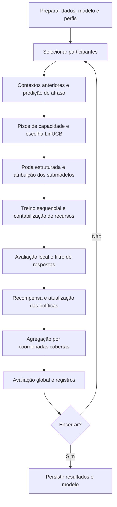

# Fluxo de execução do HERAFL na implementação atual

**Data da análise:** 30 de outubro de 2026.  
**Escopo:** implementação local do PFLlib, examinada diretamente no código-fonte. Esta descrição caracteriza o programa executável; não estabelece equivalência integral com uma formulação publicada ou com o runtime original MininetFed.

## 1. Organização e objetivo operacional

O HERAFL implementa aprendizagem federada síncrona com submodelos de dimensões heterogêneas. Em cada rodada, o servidor seleciona participantes, atribui uma fração de retenção estrutural a cada um, recebe seus parâmetros treinados e agrega as coordenadas efetivamente cobertas. A escolha da retenção combina um bandit contextual LinUCB, restrições de capacidade estática e uma estimativa online do risco de atraso.

A classe `HERAFL` especializa `FedLoad`; o ciclo de treinamento é herdado de `FedLoad.train`. Analogamente, `clientHERAFL` herda integralmente `clientFedLoad`. Assim, a diferenciação do HERAFL ocorre na política de retenção, na construção do contexto, no preditor e, fora do modo de comparação alinhada, na seleção de participantes. Não existe um otimizador local exclusivo do HERAFL.

| Componente | Responsabilidade | Código |
| --- | --- | --- |
| Orquestração | Ambiente, dataset e argumentos dos experimentos | [start.sh](../start.sh), [prepare_dataset.py](../tools/prepare_dataset.py) |
| Entrada | Argumentos, sementes, modelo e servidor | [main.py](../system/main.py) |
| Servidor especializado | Contextos estáticos, predição, seleção e prazo | [serverherafl.py](../system/flcore/servers/serverherafl.py) |
| Ciclo federado | Atribuição, treinamento, aceitação, recompensa e avaliação | [serverfedload.py](../system/flcore/servers/serverfedload.py) |
| Cliente | Treino e contabilização de recursos | [clientfedload.py](../system/flcore/clients/clientfedload.py), [clientherafl.py](../system/flcore/clients/clientherafl.py) |
| Política | LinUCB e orientação por capacidade | [linucb_hera.py](../system/flcore/heterogeneity/linucb_hera.py) |
| Preditor | Regressão online e escore de risco | [straggler.py](../system/flcore/heterogeneity/straggler.py) |
| Estrutura do modelo | Poda e agregação por coordenadas | [pruning.py](../system/flcore/heterogeneity/pruning.py) |
| Recursos e registros | Perfis, metadados e relatórios | [profiles.py](../system/flcore/heterogeneity/profiles.py), [results.py](../system/flcore/heterogeneity/results.py) |

## 2. Notação

Considere clientes \(i\in\{0,\ldots,N-1\}\), rodadas \(t\in\{1,\ldots,T\}\), conjunto selecionado \(S_t\) e conjunto de respostas aceitas \(R_t\subseteq S_t\). Seja \(w^{t-1}\) o modelo global antes da rodada, \(n_i\) o número de amostras de treinamento do cliente, \(a_{i,t}\in\mathcal A\subset(0,1]\) sua retenção e \(x_{i,t}\) seu contexto de decisão. A função \(\operatorname{clip}\) limita valores a \([0,1]\).

Embora algumas variáveis se chamem `pruning_rate`, os braços representam **frações retidas**, e não frações removidas. Uma retenção de 0,5 preserva aproximadamente metade das saídas de cada camada oculta elegível; ela não implica preservar exatamente metade dos parâmetros ou dos FLOPs da rede.

## 3. Inicialização do experimento

### 3.1. Caminho de execução pelo script

O `start.sh` ativa o ambiente Conda `pfllib`, normaliza o nome do dataset e do cenário e chama `tools/prepare_dataset.py` para reutilizar ou gerar partições compatíveis. Em seguida, obtém o número de clientes, o número de classes e o identificador do dataset, muda para `system/` e invoca `main.py` separadamente para cada algoritmo solicitado. Ao final, pode produzir os gráficos comparativos.

Na versão examinada, os valores padrão efetivos do script são:

| Parâmetro | Valor |
| --- | --- |
| Dataset e cenário | Cifar10, IID |
| Modelo | VGG16 |
| Clientes e participação | 30 e 0,2, portanto 6 selecionados por rodada |
| Rodadas e épocas locais | 30 e 5 |
| Lote e learning rate | 64 e 0,0001 |
| Braços de retenção | 10 valores igualmente espaçados entre 0,5 e 1,0 |
| LinUCB | \(\alpha=0,5\), \(\beta=0,75\), estratégia `binary` |
| Pesos de recompensa | acurácia 0,6; energia 0,1; tempo 0,3 |
| Perfil e semente da política | `paper` e 42 |
| Preditor | habilitado |
| Comparação alinhada e espera por todos | habilitadas |

Esses valores são padrões de `start.sh`, não necessariamente padrões do parser ou das classes. Variáveis de ambiente e argumentos adicionais podem alterar a execução. O script passa `-lr` explicitamente; por isso, o ajuste automático do learning rate para VGG em `main.py`, condicionado à ausência desse argumento, não substitui o valor recebido.

Há uma particularidade do script: `MODEL="${MODEL:-VGG16}"` e `LEARNING_RATE="${LEARNING_RATE:-0.0001}"` preenchem também variáveis vazias. Consequentemente, os blocos posteriores condicionados a valores vazios não selecionam automaticamente modelo e taxa de aprendizado. A compatibilidade das dimensões de entrada deve ser observada: as VGG atuais trabalham com entrada RGB de 32×32, enquanto MNIST usa um canal de 28×28.

### 3.2. Construção do estado

Para a repetição de índice \(r\), `main.py` inicializa os geradores de PyTorch, NumPy e Python com `policy_seed + r` antes de construir o modelo. O servidor valida arquitetura, proporção de participação, braços, pesos de recompensa e limites de execução. São admitidos `FedAvgCNN`, `DNN`, `Mclr_Logistic`, `MininetCNN`, `VGG11` e `VGG16`; fine tuning de novos clientes e DLG são rejeitados neste fluxo.

O servidor cria clientes, gera perfis de recursos e aplica eventuais substituições fornecidas por `--client-profiles`. Mantém, para cada cliente, um contexto inicial imutável e o contexto operacional mais recente. Também inicializa históricos de energia por braço, relatórios e contadores de tempo.

O bandit é único no servidor, compartilhado por todos os clientes. Para cada braço \(a\), inicializa:

\[
A_a=I_9,\qquad b_a=0_9.
\]

O preditor também é global e começa com matriz identidade de dimensão seis e vetor nulo. Seu parâmetro de temperatura é 0,12. O limiar nominal 0,55 é substituído pela média das previsões dos participantes quando a predição está ativa.

## 4. Protocolo de execução e seleção dos participantes

O laço percorre exatamente `range(1, global_rounds + 1)`: são \(T\) rodadas, salvo parada antecipada. A avaliação ocorre depois da agregação, sem avaliação inicial na rodada zero nesse laço.

Existem dois regimes de seleção:

1. **Comparação alinhada:** amostragem uniforme sem reposição de \(m=\max(1,\lfloor Nq\rfloor)\) clientes, com gerador `random.Random(experiment_seed + t)`. A opção `random_join_ratio`, quando ativa nesse regime, sorteia o tamanho entre \(m\) e \(N\). Essa agenda permite compartilhar participantes entre os métodos com a mesma configuração.
2. **Execução nativa não alinhada:** `StratifiedRandom` ordena os clientes por capacidade estática de CPU, divide a lista em até três estratos aproximadamente iguais e sorteia alternadamente um participante por estrato até completar a cota. Seu gerador próprio começa em 42, independentemente de `policy_seed`. Quando a cota não é múltipla de três, a ordem de visita favorece os estratos iniciais.

O `start.sh` sempre passa `--aligned-comparison`; portanto, seu HERAFL usa o primeiro regime. Além disso, `--wait-for-all` força comparação alinhada em `main.py`, zera `client_drop_rate`, desativa `time_select` e torna o prazo infinito. Desabilitar apenas `WAIT_FOR_ALL` no script não ativa a seleção estratificada, pois a comparação alinhada continua presente.

## 5. Construção do contexto e predição de atraso

### 5.1. Estado observado

O contexto usado para decidir é o último disponível: inicialmente deriva do perfil; nas participações posteriores, incorpora o resultado da última execução daquele cliente. Clientes não selecionados não têm seu contexto atualizado naquela rodada. O novo estado de recursos só é amostrado dentro de `client.train`, depois da escolha do braço.

O vetor do LinUCB é:

\[
x_{i,t}=[e_{cmp},e_{up},e_{down},f_i,d_i,c_i,\bar b_i,\widehat\tau_i,p_i]^\top.
\]

Todos os componentes são limitados a \([0,1]\). Os três primeiros são características energéticas normalizadas do perfil; \(f_i\) representa capacidade de CPU; \(d_i=n_i/\max_j n_j\); \(c_i\) representa custo computacional; \(\bar b_i\) é a média móvel da banda normalizada; \(\widehat\tau_i\) é a previsão normalizada de tempo e \(p_i\) o escore de risco.

Depois de haver treino observado, o custo computacional é:

\[
c_i=\operatorname{clip}\left(\frac{T_i^{cmp}}{\max(n_i,1)\,s_i^{cmp}}\right),
\]

com escala padrão \(s_i^{cmp}=0,002\) segundos por amostra. O código não divide esse valor pelo número de épocas. A banda instantânea é normalizada por `(throughput_mbps - 1) / 74`, e a janela do perfil `paper` contém até dez observações.

O HERAFL acrescenta quatro valores iniciais preservados: `static_cpu_capacity`, `static_compute_cost`, `static_bandwidth` e `static_energy_efficiency`. Eles evitam que a classificação estática de capacidade seja redefinida pela dimensão do submodelo escolhido anteriormente.

### 5.2. Preditor online

O vetor do preditor é:

\[
z_i=[f_i,d_i,c_i,\bar b_i,E_i^{norm},T_i^{norm}]^\top.
\]

Com estado \((A_p,b_p)\), a previsão é

\[
\widehat\tau_i=\operatorname{clip}(z_i^\top A_p^{-1}b_p).
\]

Para os selecionados, calcula-se \(h_t=|S_t|^{-1}\sum_{i\in S_t}\widehat\tau_i\), seguido de

\[
p_i=\sigma\left(\frac{\widehat\tau_i-h_t}{0,12}\right).
\]

Assim, o risco é relativo à média dos participantes da rodada. Não se trata de uma probabilidade calibrada de violar o timeout físico. Na primeira rodada, as previsões são zero e os riscos são 0,5. Desabilitar o preditor remove essas características adicionadas; a vetorização usa zero para campos ausentes, mas a orientação por capacidade permanece ativa.

## 6. Escolha contextual da retenção

### 6.1. Restrição por capacidade estática

Define-se

\[
C_i=\operatorname{clip}\left(\frac{f_i^{static}+1-c_i^{static}}{2}\right).
\]

Com os padrões atuais, \(C_i<0,40\) caracteriza capacidade baixa; \(0,40\le C_i<0,70\), média; e \(C_i\ge0,70\), alta. Os pisos solicitados de retenção são, respectivamente, \(\min\mathcal A\), 0,70 e 0,85. O piso efetivo é limitado ao maior braço disponível, preservando experimentos com espaço de ações restrito. Apenas braços maiores ou iguais ao piso efetivo são avaliados. Com os dez braços padrão, o menor elegível para capacidade média é aproximadamente 0,7222; para alta, 0,8889.

### 6.2. Retenção-alvo e orientação

Para os estados estático e dinâmico, calcula-se

\[
s=0,4\frac{f+1-c}{2}+0,25b+0,15e,
\]

onde \(b\) denota capacidade de banda e \(e\), eficiência energética. Em seguida:

\[
g_i=0,75s_i^{static}+0,25s_i^{dynamic}
-0,25\max(0,s_i^{static}-s_i^{dynamic})-0,2p_i.
\]

Se \(s_i^{static}\ge0,7\), aplica-se piso de 0,65 a \(g_i\); depois, limita-se a \([0,1]\). A retenção-alvo é

\[
a_i^*=a_{min}+g_i(a_{max}-a_{min}).
\]

Para \(\Delta=\max(a_{max}-a_{min},10^{-6})\), o bônus associado ao candidato \(a\) é

\[
G_i(a)=0,6\left(1-\frac{|a-a_i^*|}{\Delta}\right)
-0,15p_i\frac{\max(0,a-a_i^*)}{\Delta}.
\]

O bônus favorece proximidade à retenção-alvo e penaliza modelos maiores que essa referência quando o risco de atraso é elevado.

### 6.3. Exploração adaptativa e escore final

As atribuições são realizadas sequencialmente antes do treinamento. Para cada candidato, calcula-se a média das retenções já atribuídas na rodada incluindo esse candidato, \(\bar a_t(a)\). Na estratégia `binary`, com `min_alpha_ratio=0`:

\[
\alpha_t(a)=\begin{cases}\alpha,&\bar a_t(a)\ge\beta,\\0,&\text{caso contrário}.\end{cases}
\]

Na estratégia `proportional`, usa-se \(\alpha\operatorname{clip}(\bar a_t(a)/\beta)\) para \(\beta>0\), e \(\alpha\) para \(\beta\le0\). O escore é

\[
Q_i(a)=x_{i,t}^{\top}A_a^{-1}b_a+
\alpha_t(a)\sqrt{x_{i,t}^{\top}A_a^{-1}x_{i,t}}+G_i(a).
\]

Escolhe-se o braço elegível de maior escore; o gerador do bandit resolve empates. A ordem dos participantes pode influenciar escolhas pela referência das retenções já atribuídas. Os parâmetros do bandit não são atualizados entre essas atribuições: as recompensas só são processadas após os treinamentos da rodada.

## 7. Poda estruturada e distribuição dos submodelos

Para cada cliente, o servidor copia o modelo global e ordena as saídas de cada camada convolucional ou linear oculta pela norma L1 dos pesos:

\[
I_{\ell,j}=\sum_k|W_{\ell,j,k}|.
\]

São preservadas as \(\max(1,\lfloor a_{i,t}d_\ell\rfloor)\) saídas de maior importância. A importância é calculada sobre os pesos originais daquela camada, antes de restringir suas entradas. A última camada conserva todas as classes. As entradas de cada camada acompanham as saídas preservadas na anterior; na transição convolução–linear, o mapeamento respeita a ordem NCHW do `flatten`.

O resultado é uma rede fisicamente menor, acompanhada dos índices de suas coordenadas no modelo global. Não se trata apenas de zerar pesos. Os submodelos são preparados em CPU, e cada cliente recebe seu modelo, coordenadas e retenção. Para MLR, que não possui camada oculta elegível, a escolha do braço não reduz a estrutura.

## 8. Treinamento local e recursos

O cliente reconstrói seu otimizador a cada atribuição. Portanto, momentos do Adam e estados de momentum não são preservados entre participações. A taxa é \(\eta_0\) ou, com decay, \(\eta_i=\eta_0\gamma^{k_i}\), em que \(k_i\) conta treinamentos já executados pelo cliente, inclusive aqueles cuja resposta posteriormente é rejeitada.

Modelos com `optimizer_kind='adam'`, incluindo VGG11 e VGG16, usam Adam com `eps=1e-7`. No treinamento de referência MininetCNN, a configuração com aumento de dados usa Adam; a outra usa SGD com momentum 0,9 e decaimento desacoplado dos parâmetros de intensidade \(5\times10^{-4}\). Os demais casos usam SGD. A função de perda é entropia cruzada.

O `DataLoader` local embaralha os dados e usa `drop_last=False`. Em cada época e lote, executam-se limpeza dos gradientes, propagação direta, retropropagação e atualização. A simulação opcional de clientes lentos reduz épocas e acrescenta esperas. No modo alinhado, antes de cada treino os geradores recebem uma semente dependente de repetição, rodada e cliente; o gerador de recursos usa `SeedSequence` com esses mesmos identificadores. Isso controla fontes de aleatoriedade, mas não assegura igualdade dos tempos medidos.

O estado sintético inclui throughput sorteado entre 1 Mbps e o máximo do perfil, frequência de CPU e ciclos computacionais. Esses atributos orientam a política, mas não impõem cotas físicas de CPU/GPU. Os clientes treinam sequencialmente no mesmo processo.

O tempo de computação é medido com `perf_counter` e sincronização CUDA quando aplicável. Para \(B_i\) bytes de parâmetros e banda \(v_i\) em Mbps:

\[
T_i^{down}=T_i^{up}=\frac{8B_i}{10^6v_i},\qquad
T_i=T_i^{cmp}+T_i^{down}+T_i^{up},
\]

\[
E_i=P_i^{cmp}T_i^{cmp}+P_i^{down}T_i^{down}+P_i^{up}T_i^{up}.
\]

O volume total de comunicação é \(2B_i\). Não inclui índices de poda, estados do otimizador, serialização ou cabeçalhos de rede. Energia e comunicação são estimadas; somente o tempo de treino é medido. Avaliação local, poda e agregação não entram em \(T_i^{cmp}\), mas contribuem para o tempo de parede do servidor.

## 9. Aceitação, recompensa e aprendizagem das políticas

### 9.1. Respostas aceitas

Todos os selecionados executam o treino, mesmo que sejam posteriormente classificados como descartados. A aceitação requer pertencer ao subconjunto ativo definido por `client_drop_rate` e satisfazer o prazo; `time_select`, quando habilitado, acrescenta outro limite. O timeout filtra a resposta depois do treino, sem interrompê-lo.

Com `wait_for_all`, todas as respostas concluídas são aceitas. Sem essa opção, a comparação alinhada usa o prazo-base, normalmente 180 segundos. Fora do modo alinhado, com preditor ativo, o prazo pode ser ampliado para o máximo entre o prazo-base, 1,35 vezes a maior previsão convertida em segundos e 1,5 vezes a média dessas previsões.

Após o treino, o cliente atualiza seu contexto e mede a acurácia de seu submodelo na partição local de teste. Essa avaliação ocorre inclusive para respostas rejeitadas. O submodelo é então transferido para CPU, e o otimizador local é descartado.

### 9.2. Recompensa

Para respostas aceitas, a referência temporal é a média dos tempos dos aceitos na rodada. A referência energética é a média histórica de energia do braço escolhido, considerando rodadas anteriores; sem histórico, usa-se a energia da própria resposta. Define-se

\[
U(v;v_{ref})=\operatorname{clip}\left(1-\frac{|v-v_{ref}|}{v_{ref}}\right)
\]

para referência positiva e observação não negativa; nos demais casos, a função retorna 1. A recompensa é

\[
r_{i,t}=0,6\,Acc_{i,t}+0,1\,U(E_i;E_{ref,a})+0,3\,U(T_i;T_{ref,t}).
\]

As utilidades de tempo e energia medem proximidade à referência, não redução monotônica de consumo: valores muito inferiores à referência também podem receber utilidade menor. O histórico energético é acrescido somente depois do processamento das recompensas da rodada, evitando dependência da ordem dentro dessa etapa.

### 9.3. Atualizações online

No HERAFL, a recompensa atualiza o bandit com o **contexto usado na decisão**, e não com o contexto medido após o treino:

\[
A_a\leftarrow A_a+x_{i,t}x_{i,t}^{\top},\qquad
b_a\leftarrow b_a+r_{i,t}x_{i,t}.
\]

O preditor também aprende com o contexto de decisão e um alvo observado \(y_i\):

\[
A_p\leftarrow A_p+z_iz_i^{\top},\qquad b_p\leftarrow b_p+y_iz_i.
\]

Somente respostas aceitas atualizam bandit, preditor e histórico energético. Respostas rejeitadas ainda atualizam o contexto operacional do cliente, mas não fornecem recompensa negativa à política.

**Particularidade de escala existente:** `HERAFL.update_policy` calcula o alvo como `clip(round_time / max(context.get('round_time_scale', 1.0), 1.0), 0, 1)`. Entretanto, `get_context` não inclui `round_time_scale`. No caminho atual, portanto, \(y_i=\operatorname{clip}(T_i/1\text{ s})\), saturando em 1 para tempos de pelo menos um segundo. Isso difere da característica `round_time` do contexto, normalizada pela escala do perfil, geralmente 120 segundos. A conversão de previsão para prazo adaptativo usa ainda o fallback de 60 segundos. Essa divergência deve ser considerada na interpretação do preditor; a presente documentação não a corrige.

## 10. Agregação por cobertura de coordenadas

Seja \(m_{i,j}\in\{0,1\}\) a indicação de que o submodelo do cliente cobre a coordenada global \(j\), e \(\widetilde w_{i,j}\) seu valor treinado. O servidor calcula

\[
w_j^t=\begin{cases}
\displaystyle\frac{\sum_{i\in R_t}n_im_{i,j}\widetilde w_{i,j}}{\sum_{i\in R_t}n_im_{i,j}},&\sum_{i\in R_t}n_im_{i,j}>0,\\
w_j^{t-1},&\text{caso contrário}.
\end{cases}
\]

A normalização é específica de cada coordenada. Ausência de cobertura não equivale a contribuição zero: a coordenada conserva o valor global anterior. Se não houver respostas aceitas, todo o modelo permanece inalterado.

A implementação acumula numeradores e denominadores em CPU, um parâmetro por vez, e devolve apenas o modelo global resultante ao dispositivo original. Isso evita materializar reconstruções densas de todos os clientes na GPU.

## 11. Avaliação, encerramento e persistência

Nas rodadas múltiplas de `eval_gap`, todos os clientes recebem uma referência ao modelo global completo para avaliação. A acurácia global é a razão entre o total de acertos e o total de exemplos de teste. A perda de treinamento é ponderada pelas amostras efetivamente avaliadas; o carregador de treinamento herdado usa `drop_last=True` nessa avaliação. A AUC exibida é uma média ponderada das AUCs locais, e os desvios padrão impressos são calculados entre as métricas dos clientes.

A acurácia global difere da média aritmética das acurácias dos submodelos aceitos, registrada em `round_summary.csv`. A primeira mede o modelo agregado em todas as partições de teste; a segunda resume os submodelos locais dos participantes aceitos.

A rotina `Server.evaluate` calcula e imprime AUC, mas não acrescenta o resultado a `rs_test_auc` na versão examinada. Embora o HDF5 contenha um dataset com esse nome, sua série pode permanecer vazia. O relatório deve distinguir métricas impressas de séries efetivamente persistidas.

Cada rodada registra retenções, contextos de decisão e resposta, status, recursos, informações da política e, para respostas aceitas, recompensa e contexto de aprendizagem. O tempo de parede em `Budget` inclui o processamento da rodada; não corresponde à média ou ao máximo dos tempos modelados dos clientes. A média de tempo impressa ao final exclui a primeira rodada quando há mais de uma.

Ao atingir \(T\) ou satisfazer a parada antecipada opcional, o servidor salva:

- HDF5 com acurácia, índices das rodadas avaliadas, perda e campo de AUC;
- checkpoint em `system/models/<dataset>/HERAFL_server.pt`, relativo à execução pelo script, cujo nome não distingue repetições;
- diretório `results/herafl/<timestamp>_hera_fl_experiment_<dataset>_<scenario>_run<r>/`;
- `config.json` com parâmetros e perfis efetivos e `<stem>_policy.json` com os relatórios;
- `analysis/<stem>/csv/{round_clients,round_summary,selections}.csv` e gráficos em `analysis/<stem>/plots/`.

O timestamp de resultados usa `America/Belem`. O processo externo pode gerar, adicionalmente, comparações entre os algoritmos executados.

## 12. Síntese algorítmica

```text
Inicializar modelo global, clientes, perfis, contextos, LinUCB e preditor
Para t = 1, ..., T:
    Selecionar participantes conforme o regime de execução
    Copiar contextos disponíveis e acrescentar características estáticas
    Estimar tempos e riscos, se o preditor estiver habilitado
    Definir o prazo de aceitação
    Para cada participante, antes de qualquer treino:
        Restringir braços pela capacidade estática
        Calcular alvo, exploração e escores LinUCB
        Escolher retenção e construir submodelo com suas coordenadas
        Reconstruir otimizador local
    Para cada participante, sequencialmente:
        Amostrar estado de recursos e treinar submodelo
        Medir computação e estimar comunicação e energia
        Atualizar contexto operacional e determinar aceitação
        Avaliar acurácia local e transferir submodelo para CPU
    Calcular referência temporal das respostas aceitas
    Para cada resposta aceita:
        Calcular recompensa usando histórico energético anterior
        Atualizar LinUCB e preditor com o contexto da decisão
        Registrar contribuição para agregação
    Acrescentar energias aceitas aos históricos
    Agregar coordenadas cobertas, preservando as demais
    Avaliar modelo global se t for múltiplo de eval_gap
    Registrar relatório e verificar parada antecipada
Salvar métricas, modelo global, configuração, relatórios e gráficos
```



## 13. Condições para interpretação científica

A implementação combina treinamento real com um modelo de recursos: não há rede distribuída nem execução paralela entre dispositivos independentes. Perfis de capacidade não limitam fisicamente os recursos do processo. As estimativas energéticas não correspondem a medições de consumo elétrico.

A recompensa usa a partição local de teste para orientar escolhas futuras. Portanto, esse conjunto participa da adaptação da política e não deve ser descrito como um teste inteiramente independente do processo de seleção. Uma avaliação que exija independência deve separar validação para a recompensa e teste final.

A comparação alinhada controla agenda de participantes, sementes e ciclo federado. Nesse modo, `main.py` instancia `ComparisonFedAvg`, que herda o mesmo ciclo e fixa a retenção em 1, em vez de usar o ciclo nativo de `clientAVG`. Ainda assim, diferenças de dimensões, sequências de operações e tempos medidos podem produzir trajetórias distintas.

As distinções entre seleção estratificada e uniforme, prazo infinito e adaptativo, contexto de decisão e contexto de resposta, assim como a divergência de escala do preditor, são propriedades relevantes do código atual. Elas devem ser explicitadas ao descrever experimentos, evitando atribuir a uma execução funcionalidades que estavam desabilitadas ou operavam sob outro regime.
